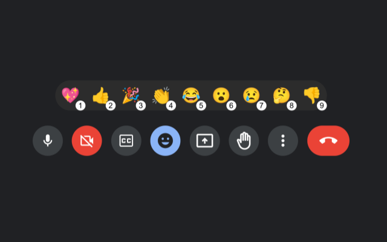

# Meet emoji reaction by key (Browser Extension)

Emoji Reaction By Key on meet is a browser extension that allows you to easily add emoji reactions during Google Meet meetings. When you install this extension, emoji reactions corresponding to the numbers you press on your keyboard will be displayed on the Meet emoji bar. You can simply press the keys to send reactions quickly.

> This package was created using [vitesse-webext](https://github.com/antfu/vitesse-webext).


## Features



- **Efficient Reactions**: Send emoji reactions directly from your keyboard without the need to click through the reaction menu. This streamlines communication and makes it more seamless.
- **Compatibility**: Fully compatible with the Google Meet platform.
- **Easy Download**: You can [download the extension from the Chrome Web Store](https://chromewebstore.google.com/u/2/detail/emoji-reaction-by-key-on/bfgccanlnmpkpflhadgogeimoeodjomb?hl=ja).

## Usage

During a meeting, type the number keys (1-9) on your keyboard. As you type the keys, emoji reactions corresponding to them will appear on the Meet emoji bar and will be instantly conveyed to other participants in real-time.

Press `0` to open the emoji picker. The search box is focused automatically, so type a keyword (in your Meet display language) and press `Enter` to send the first matching emoji. The picker closes after sending.

### Favorites

- Press `Shift` + `1`-`9` to send your favorite emojis, even ones not on the emoji bar.
- Hold `Shift` to see your favorites above the emoji bar. Click the `⇧` button next to the bar to keep them shown.
- Right-click any emoji on the bar or in the picker to add it to a favorite slot. You can undo the change from the notice that appears.
- Open the extension popup to reorder, clear, or reset your favorites.

Keys are ignored while you are typing (chat, Gemini, search boxes) or after you click inside the side panel. Click outside the side panel to use them again.

**Note**: When you install this extension, emoji reactions corresponding to the numbers you type will be displayed on the Meet emoji bar. However, if other extensions have assigned different actions to number keys, Meet Emoji Reactions may not function correctly. In such cases, you may need to adjust the settings of other extensions.

## Development

### Folders

- `src` - main source.
  - `contentScript` - scripts and components to be injected as `content_script`
  - `background` - scripts for background.
  - `components` - auto-imported Vue components that are shared in popup and options page.
  - `styles` - styles shared in popup and options page.
  - `assets` - assets used in Vue components.
  - `manifest.ts` - manifest for the extension.
- `extension` - extension package root.
  - `assets` - static assets (mainly for `manifest.json`).
  - `dist` - built files, also serve stub entry for Vite on development.
- `scripts` - development and bundling helper scripts.

```bash
pnpm dev
```

Then load the extension in a browser using the `extension/` folder.

For Firefox developers, you can run the following command instead:

```bash
pnpm start:firefox
```

`web-ext` auto reloads the extension when `extension/` files change.

> While Vite handles HMR automatically in most cases, [Extensions Reloader](https://chrome.google.com/webstore/detail/fimgfedafeadlieiabdeeaodndnlbhid) is still recommended for cleaner hard reloading.

### Build

To build the extension, run:

```bash
pnpm build
```

To try a production build locally, run `pnpm build:local` instead. It adds the build time to the extension name (e.g. `Emoji Reaction By Key on meet (local 10-13 16:21)`) so you can tell which build is loaded. Don't pack this build.

Then, run `pnpm run pack` (it runs the store build first and packs the files under `extension`). You can upload `extension.crx` or `extension.xpi` to the appropriate extension store.
